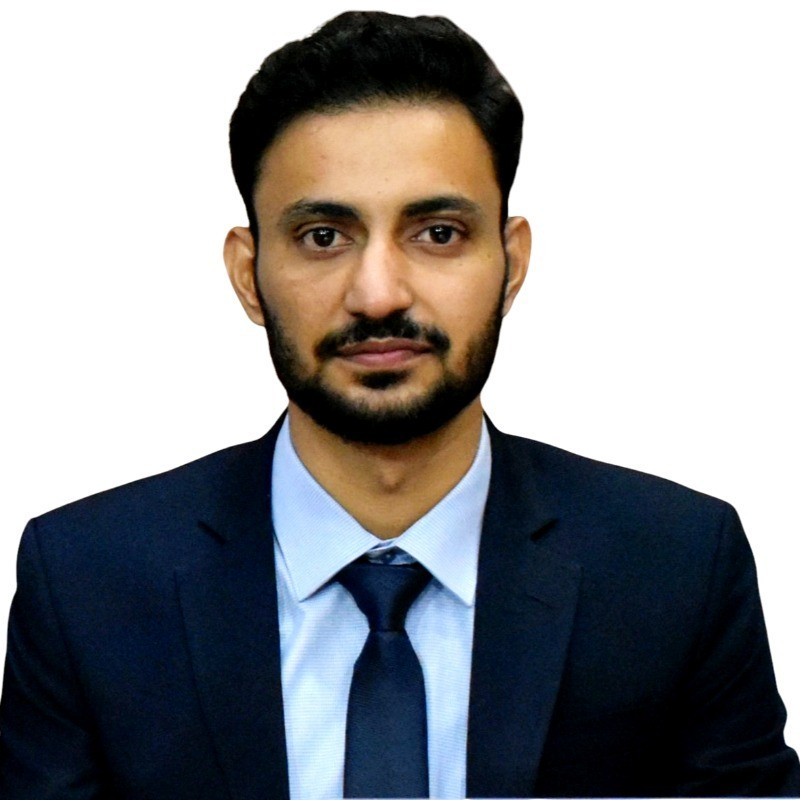

```{=html}
<div class="about-head">
  
  <div>
    <p class="lead-text" style="margin:0">I'm a software engineer moving into machine learning and data
    science. I build data tools that real businesses use every day, and I'm now doing an MS in
    Data Science to put that engineering on solid statistical and research ground.</p>
    <div class="actions">
      <a class="btn-hz primary" href="assets/cv/Huzeifa_Asif_CV.pdf" download><i class="bi bi-download"></i> Download CV</a>
      <a class="btn-hz" href="mailto:huzeifa888@gmail.com"><i class="bi bi-envelope"></i> huzeifa888@gmail.com</a>
      <a class="btn-hz" href="https://www.linkedin.com/in/huzeifaasif"><i class="bi bi-linkedin"></i> LinkedIn</a>
      <a class="btn-hz" href="https://github.com/HUZEIFAC7"><i class="bi bi-github"></i> GitHub</a>
    </div>
  </div>
</div>
```

## What I focus on

**NLP and human–AI interaction**, **predictive maintenance**, **supply chain risk** and
**computer vision**: problems where a model's output turns into a decision someone has to
act on. I care about doing the unglamorous parts right: leakage-free splits, honest
baselines, calibrated probabilities and error analysis that says where a model fails.

## Experience

::: {.role}
::: {.role-head}
[Software Engineer]{.role-title}
[Mar 2025 – present · remote]{.role-when}
:::
[Zahrh Esther Hardware Trading LLC · Sharjah, UAE]{.role-org}

- Built and shipped a multi-user **Cheque Management System** (Electron, React,
  TypeScript, Supabase) used live by the finance team across several office computers.
- Shipped a **Python desktop application** (PyQt5, pandas) that automates financial and
  accounting tasks, replacing manual Excel workflows.
- Automated the finance team's data processing and reporting with Python and Excel.

[See the software →](software.qmd)
:::

::: {.role}
::: {.role-head}
[Data Science Intern]{.role-title}
[3-month internship]{.role-when}
:::
[Tab Solutions · Lahore, Pakistan]{.role-org}

- Cleaned and analysed business datasets with Python and pandas.
- Built and tested machine learning models and presented the results to the team.
:::

## Education

::: {.edu-grid}
::: {.role}
[2026 – present]{.role-when}

[MS Data Science]{.role-title}

[University of Central Punjab, Lahore]{.role-org}

Machine Learning · Advanced Human–Computer Interaction · Big Data.
[Research paper on chatbot preference prediction →](projects/hci-chatbot-preference.qmd)
:::
::: {.role}
[2021 – 2025]{.role-when}

[BSc Computer Science]{.role-title}

[Bahria University, Lahore]{.role-org}

Academic Excellence Certificate (Fall 2024). Final-year project: **EyeQ**, eye tracking
to measure quiz difficulty, tested with 20 students.
:::
:::

## Skills

::: {.skill-grid}
::: {.skill}
#### Code
Python · SQL · TypeScript · JavaScript · C++
:::
::: {.skill}
#### Machine learning
scikit-learn · PyTorch · TensorFlow · Hugging Face Transformers · LightGBM · SHAP · OpenCV
:::
::: {.skill}
#### Data
pandas · NumPy · PySpark · PostgreSQL · SQLite · Supabase · Excel · Power BI (basic)
:::
::: {.skill}
#### Apps
React · React Native / Expo · Electron · PyQt5 · Tailwind
:::
::: {.skill}
#### Tools
Git · Linux (Ubuntu) · Jupyter · Quarto · uv · VS Code
:::
::: {.skill}
#### Languages
Urdu (native) · English (professional working proficiency)
:::
:::

## Beyond code

::: {.edu-grid}
::: {.role}
[Family business]{.role-title}

I help run my family's restaurant in Lahore (staff, suppliers and marketing), which is
also why its point-of-sale system is built the way it is.
:::
::: {.role}
[Leadership]{.role-title}

**Google Developer Student Clubs**, Bahria University Lahore: core team member of the AI
team (2023–2024).
:::
::: {.role}
[Badminton]{.role-title}

Captain of the Bahria University Lahore team. **Gold** in singles and doubles (2024),
**silver** in doubles (2022).
:::
:::
