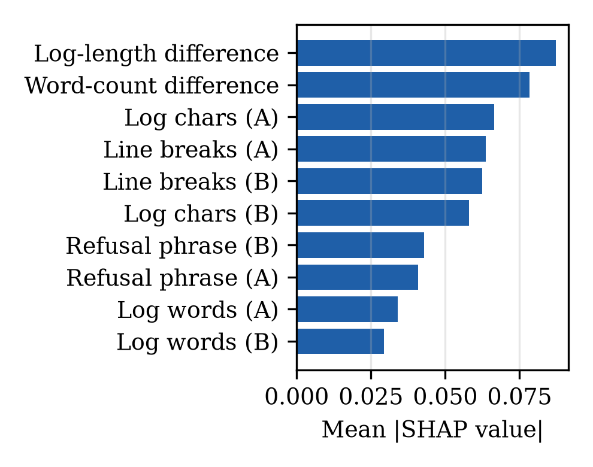
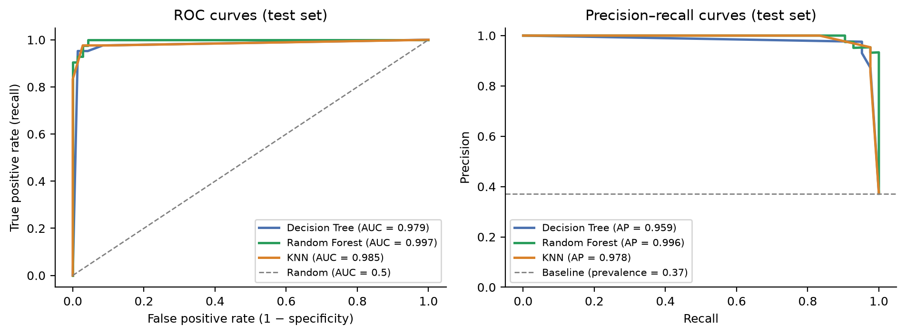

```{=html}
<section class="hero">
  <div class="hero-inner">
    <div class="hero-text">
      <span class="eyebrow"><i class="bi bi-geo-alt"></i> Lahore, Pakistan · open to data science roles</span>
      <h1 class="hero-name">Huzeifa Asif<span class="dot">.</span></h1>
      <p class="hero-role">Software engineer <span class="arrow">→</span> machine learning &amp; data science</p>
      <p class="hero-lead">
        I build data tools that real businesses use every day, and I now bring the same care to
        machine learning: from a style-aware transformer that predicts which chatbot answer people
        prefer, to clinical classifiers tuned for the cost of a missed diagnosis, to Spark pipelines
        for supply-chain risk.
      </p>
      <div class="hero-cta">
        <a class="btn-hero primary" href="#work">See my work <i class="bi bi-arrow-down"></i></a>
        <a class="btn-hero accent" href="assets/cv/Huzeifa_Asif_CV.pdf" download><i class="bi bi-download"></i> Download CV</a>
        <a class="btn-hero ghost" href="projects/hci-chatbot-preference.html"><i class="bi bi-journal-text"></i> Read the research</a>
        <a class="btn-hero ghost" href="https://github.com/HUZEIFAC7"><i class="bi bi-github"></i> GitHub</a>
      </div>
    </div>
    <div class="hero-now" role="complementary" aria-label="Right now">
      <span class="now-title"><i class="bi bi-lightning-charge"></i> Right now</span>
      <ul>
        <li><i class="bi bi-briefcase"></i><div><b>Software Engineer</b>Zahrh Esther Hardware Trading, remote</div></li>
        <li><i class="bi bi-journal-text"></i><div><b>Research paper</b>SA-DeBERTa · 57,215 chatbot battles</div></li>
        <li><i class="bi bi-broadcast live"></i><div><b>Software in daily use</b>UAE and Pakistan</div></li>
        <li><i class="bi bi-hdd-network amber"></i><div><b>In progress</b>Supply-chain risk with PySpark</div></li>
      </ul>
    </div>
  </div>
</section>

<div class="stat-strip">
  <div><b>48.4%</b><span>3-way accuracy predicting human preference between LLM answers (chance 33%)</span></div>
  <div><b>41 / 42</b><span>cancers detected on an untouched test set by the tuned KNN</span></div>
  <div><b>3</b><span>apps in daily use by businesses in the UAE and Pakistan</span></div>
  <div><b>4</b><span>data science projects, from hand-derived trees to Spark</span></div>
</div>

<section class="block">
  <div class="block-head">
    <div><span class="kicker">Focus</span><h2>What I work on</h2></div>
  </div>
  <div class="pillars">
    <div class="pillar">
      <div class="p-icon"><i class="bi bi-chat-dots"></i></div>
      <h3>NLP &amp; human–AI interaction</h3>
      <p>Transformers that model how people judge AI answers, and what that says about interface design.</p>
    </div>
    <div class="pillar">
      <div class="p-icon"><i class="bi bi-diagram-3"></i></div>
      <h3>Machine learning</h3>
      <p>Leakage-free evaluation, calibrated probabilities and decisions driven by the real cost of errors.</p>
    </div>
    <div class="pillar">
      <div class="p-icon"><i class="bi bi-hdd-network"></i></div>
      <h3>Big data</h3>
      <p>Distributed pipelines with PySpark and MLlib for supply-chain and predictive-maintenance problems.</p>
    </div>
    <div class="pillar">
      <div class="p-icon"><i class="bi bi-box-seam"></i></div>
      <h3>Software that ships</h3>
      <p>Desktop and mobile apps with offline mode, tests and real users who depend on them.</p>
    </div>
  </div>
</section>

<section id="work" class="block">
  <div class="block-head">
    <div><span class="kicker">Featured research</span><h2>Predicting what people prefer</h2></div>
  </div>
  <a class="feature" href="projects/hci-chatbot-preference.html">
    <div class="feature-art">
      <span class="fa-title">Test accuracy · 5,738 held-out battles</span>
      <div class="mini-bars" role="img" aria-label="Accuracy: majority class 35.2%, text-only DeBERTa 43.2%, LightGBM 46.5%, TF-IDF 46.8%, SA-DeBERTa 47.4%, ensemble 48.4%">
        <div class="mini-bar"><span class="lbl">Majority class</span><span class="track"><span class="fill" style="width:70.3%"></span></span><span class="val">35.2%</span></div>
        <div class="mini-bar"><span class="lbl">DeBERTa text-only</span><span class="track"><span class="fill" style="width:86.4%"></span></span><span class="val">43.2%</span></div>
        <div class="mini-bar"><span class="lbl">LightGBM (style)</span><span class="track"><span class="fill" style="width:92.9%"></span></span><span class="val">46.5%</span></div>
        <div class="mini-bar"><span class="lbl">TF-IDF + LR</span><span class="track"><span class="fill" style="width:93.7%"></span></span><span class="val">46.8%</span></div>
        <div class="mini-bar me"><span class="lbl">SA-DeBERTa</span><span class="track"><span class="fill" style="width:94.7%"></span></span><span class="val">47.4%</span></div>
        <div class="mini-bar me"><span class="lbl">SA-DeBERTa-Ens</span><span class="track"><span class="fill" style="width:96.8%"></span></span><span class="val">48.4%</span></div>
      </div>
      <span class="fa-note">Bars on a 0–50% scale. Three classes: A preferred, B preferred, tie.</span>
    </div>
    <div class="feature-body">
      <span class="badge-status research">Research paper · Advanced HCI</span>
      <h3>Which chatbot answer will people prefer? A style-aware transformer on Chatbot Arena data</h3>
      <p>SA-DeBERTa reads a prompt and two LLM answers together and fuses them with 16
         interpretable style features. Trained on 57,215 real user votes between 64 models, it beats
         every baseline, and SHAP analysis shows that <b>answer length is the strongest driver of what
         people prefer</b>.</p>
      <div class="chips"><span>PyTorch</span><span>DeBERTa-v3</span><span>LightGBM</span><span>SHAP</span><span>Calibration</span></div>
      <span class="more">Read the case study <i class="bi bi-arrow-right"></i></span>
    </div>
  </a>
</section>

<section class="block">
  <div class="block-head">
    <div><span class="kicker">Projects</span><h2>Data science &amp; machine learning</h2></div>
    <div class="filters" role="group" aria-label="Filter projects">
      <button type="button" data-filter="all" aria-pressed="true">All</button>
      <button type="button" data-filter="hci" aria-pressed="false">HCI &amp; NLP</button>
      <button type="button" data-filter="ml" aria-pressed="false">Machine learning</button>
      <button type="button" data-filter="bigdata" aria-pressed="false">Big data</button>
    </div>
  </div>
  <div class="card-grid" id="project-grid">
    <a class="wcard" data-tags="hci ml" href="projects/hci-chatbot-preference.html">
      <div class="thumb"></div>
      <div class="wbody">
        <div class="meta"><span class="org">Advanced HCI</span><span class="badge-status research">Paper</span></div>
        <h3>Chatbot preference prediction</h3>
        <p>A DeBERTa cross-encoder with style features, swap augmentation and a calibrated ensemble.</p>
        <p class="result">48.4% accuracy · 64.4% on clear winners</p>
        <div class="chips"><span>Transformers</span><span>NLP</span><span>SHAP</span></div>
      </div>
    </a>
    <a class="wcard" data-tags="ml" href="projects/ml-breast-cancer.html">
      <div class="thumb"></div>
      <div class="wbody">
        <div class="meta"><span class="org">Machine learning</span></div>
        <h3>Breast cancer diagnosis: DT vs RF vs KNN</h3>
        <p>Leakage-free tuning, validation curves and a decision threshold chosen by the cost of a missed cancer.</p>
        <p class="result">97.4% accuracy · 41 of 42 cancers found</p>
        <div class="chips"><span>scikit-learn</span><span>Pipelines</span><span>Cost analysis</span></div>
      </div>
    </a>
    <a class="wcard" data-tags="ml" href="projects/ml-id3-student-outcomes.html">
      <div class="thumb icon"><i class="bi bi-diagram-2"></i></div>
      <div class="wbody">
        <div class="meta"><span class="org">Machine learning</span></div>
        <h3>Student outcomes: ID3 by hand and in code</h3>
        <p>Every entropy and information gain derived by hand, then verified with a from-scratch ID3. Try the tree yourself.</p>
        <p class="result">9 / 9 hand-computed gains verified</p>
        <div class="chips"><span>Entropy</span><span>Decision trees</span><span>Interactive</span></div>
      </div>
    </a>
    <a class="wcard" data-tags="bigdata ml" href="projects/bigdata-supply-chain.html">
      <div class="thumb icon amber"><i class="bi bi-truck"></i></div>
      <div class="wbody">
        <div class="meta"><span class="org">Big data</span><span class="badge-status progress">In progress</span></div>
        <h3>Supply chain delay prediction</h3>
        <p>Predicting late deliveries at order time on the DataCo dataset, with a leakage audit and Spark MLlib pipelines.</p>
        <div class="chips"><span>PySpark</span><span>MLlib</span><span>Classification</span></div>
      </div>
    </a>
    <div class="wcard" data-tags="bigdata ml">
      <div class="thumb icon amber"><i class="bi bi-airplane-engines"></i></div>
      <div class="wbody">
        <div class="meta"><span class="org">Predictive maintenance</span><span class="badge-status progress">In progress</span></div>
        <h3>Aircraft engine failure prediction</h3>
        <p>Predicting the remaining useful life of turbofan engines from multivariate sensor time series (NASA C-MAPSS).</p>
        <div class="chips"><span>Python</span><span>Time series</span><span>Regression</span></div>
      </div>
    </div>
  </div>
</section>

<section class="block">
  <div class="block-head">
    <div><span class="kicker">In production</span><h2>Software people use every day</h2>
    <p>Built for my father's trading company, my family's restaurant and plant nurseries across Pakistan.</p></div>
    <a class="btn-hz" href="software.html">All software <i class="bi bi-arrow-right"></i></a>
  </div>
  <div class="dev-grid">
    <a class="dcard" href="software.html#cheque-system">
      <div class="d-top"><div class="d-icon"><i class="bi bi-bank"></i></div><span class="badge-status live">Live</span></div>
      <h3>Cheque Management System</h3>
      <p>Write, print and track supplier cheques across office PCs, with offline mode, roles, backups and a full change log.</p>
      <div class="chips"><span>Electron</span><span>TypeScript</span><span>Supabase</span></div>
    </a>
    <a class="dcard" href="software.html#pakistan-plants-billing">
      <div class="d-top"><div class="d-icon"><i class="bi bi-flower1"></i></div><span class="badge-status live">Live</span></div>
      <h3>Pakistan Plants billing</h3>
      <p>Bilingual English/Urdu billing for nurseries: 280+ plants, credit tracking and WhatsApp-ready PDF invoices.</p>
      <div class="chips"><span>React Native</span><span>Expo</span><span>Supabase</span></div>
    </a>
    <a class="dcard" href="software.html#dimsum-pos">
      <div class="d-top"><div class="d-icon"><i class="bi bi-receipt"></i></div></div>
      <h3>DimSum POS</h3>
      <p>Offline-first restaurant point-of-sale with kitchen tickets, thermal receipts and shift cash reconciliation.</p>
      <div class="chips"><span>Electron</span><span>React</span><span>Drizzle</span></div>
    </a>
    <a class="dcard" href="software.html#eyeq">
      <div class="d-top"><div class="d-icon"><i class="bi bi-eye"></i></div></div>
      <h3>EyeQ</h3>
      <p>Final-year project: eye tracking with computer vision to measure quiz difficulty, tested with 20 students.</p>
      <div class="chips"><span>OpenCV</span><span>TensorFlow</span><span>React Native</span></div>
    </a>
  </div>
</section>

<section class="block two-col">
  <div>
    <div class="block-head"><div><span class="kicker">Path</span><h2>Experience &amp; education</h2></div></div>
    <ol class="timeline">
      <li class="hl"><span class="when">Nov 2026</span><b>Research paper: SA-DeBERTa</b><em>Chatbot preference prediction, Advanced HCI</em></li>
      <li class="hl"><span class="when">Oct 2026</span><b>Cheque Management System goes live</b><em>Zahrh Esther Hardware Trading, Sharjah</em></li>
      <li><span class="when">Mar 2025 – now</span><b>Software Engineer (remote)</b><em>Zahrh Esther Hardware Trading LLC, UAE</em></li>
      <li><span class="when">3-month internship</span><b>Data Science Intern</b><em>Tab Solutions, Lahore</em></li>
      <li><span class="when">2021 – 2025</span><b>BSc Computer Science</b><em>Bahria University, Lahore · Academic Excellence Certificate</em></li>
    </ol>
  </div>
  <div>
    <div class="block-head"><div><span class="kicker">Toolbox</span><h2>What I work with</h2></div></div>
    <div class="toolbox">
      <h4>Machine learning &amp; NLP</h4>
      <div class="chips lg"><span>Python</span><span>scikit-learn</span><span>PyTorch</span><span>TensorFlow</span><span>Transformers</span><span>LightGBM</span><span>SHAP</span><span>OpenCV</span></div>
      <h4>Data</h4>
      <div class="chips lg"><span>pandas</span><span>NumPy</span><span>PySpark</span><span>SQL</span><span>PostgreSQL</span><span>Supabase</span><span>Excel</span></div>
      <h4>Software</h4>
      <div class="chips lg"><span>TypeScript</span><span>React</span><span>React Native</span><span>Electron</span><span>PyQt5</span></div>
      <h4>Tools</h4>
      <div class="chips lg"><span>Git</span><span>Linux</span><span>Jupyter</span><span>Quarto</span><span>uv</span></div>
    </div>
  </div>
</section>

<section class="cta-band">
  <div>
    <h2>Let's talk</h2>
    <p>Open to data science and machine learning internships, research collaborations and graduate opportunities.</p>
  </div>
  <div class="hero-cta">
    <a class="btn-hero primary" href="mailto:huzeifa888@gmail.com"><i class="bi bi-envelope"></i> Email me</a>
    <a class="btn-hero accent" href="assets/cv/Huzeifa_Asif_CV.pdf" download><i class="bi bi-download"></i> CV</a>
    <a class="btn-hero ghost" href="https://www.linkedin.com/in/huzeifaasif"><i class="bi bi-linkedin"></i> LinkedIn</a>
  </div>
</section>

<p class="built-note"><i class="bi bi-gear"></i> Built with Quarto and Python. Every chart on the project
pages is computed from that project's own result files when the site is built.</p>

<script>
document.addEventListener("DOMContentLoaded", () => {
  const buttons = document.querySelectorAll(".filters button");
  const cards = document.querySelectorAll("#project-grid .wcard");
  buttons.forEach(b => b.addEventListener("click", () => {
    const f = b.dataset.filter;
    buttons.forEach(x => x.setAttribute("aria-pressed", x === b ? "true" : "false"));
    cards.forEach(c => c.classList.toggle("hidden", f !== "all" && !c.dataset.tags.split(" ").includes(f)));
  }));
});
</script>
```
