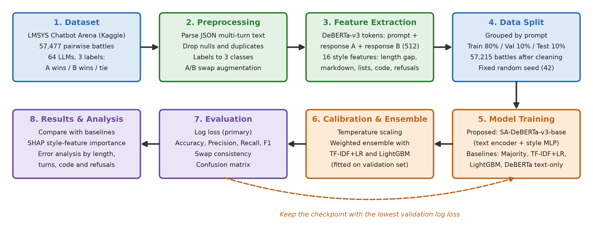

```{=html}
<div class="case-head">
  <span class="badge-status research">Research paper · Advanced HCI</span>
</div>
<div class="actions">
  <a class="btn-hz primary" href="../assets/papers/SA-DeBERTa_Chatbot_Preference_Paper.pdf"><i class="bi bi-file-earmark-pdf"></i> Read the paper (PDF)</a>
  <a class="btn-hz" href="https://github.com/HUZEIFAC7/Advance_Human_Computer_Interaction"><i class="bi bi-github"></i> Code repository</a>
  <a class="btn-hz" href="https://www.kaggle.com/competitions/lmsys-chatbot-arena/data"><i class="bi bi-database"></i> Dataset (Kaggle)</a>
</div>
<div class="glance">
  <div><span>Question</span><p>Given a prompt and two chatbot answers, which one will a real user prefer, or is it a tie?</p></div>
  <div><span>Data</span><p>57,215 head-to-head battles between 64 LLMs (LMSYS Chatbot Arena)</p></div>
  <div><span>Model</span><p>DeBERTa-v3 cross-encoder fused with 16 interpretable style features</p></div>
  <div><span>Stack</span><p>PyTorch · Hugging Face · LightGBM · SHAP · scikit-learn</p></div>
  <div><span>Authors</span><p><b>Huzeifa Asif</b>, Kashif Bacha</p></div>
</div>
```

```{python}
#| label: setup
import json
import pandas as pd
import plotly.graph_objects as go
from plotly.subplots import make_subplots
from IPython.display import HTML, display
from py.charts import show, load_json, table, INDIGO, AMBER, SLATE, SLATE_DARK, TEAL, TEXT

stats = load_json("hci", "data_stats.json")
res = pd.read_csv("data/hci/results_table.csv")
err = load_json("hci", "error_analysis.json")
sa = load_json("hci", "sa_deberta.json")
ens = load_json("hci", "sa_deberta_ensemble.json")
shap = load_json("hci", "shap_lightgbm.json")
sa1 = load_json("hci", "sa_deberta_e1.json")  # SA-DeBERTa after 1 epoch: same budget as the text-only model
```

```{python}
#| output: asis
sa_acc = res.loc[res.Model == "SA-DeBERTa (proposed)", "Accuracy (%)"].item()
txt_acc = res.loc[res.Model == "DeBERTa-v3 (text only)", "Accuracy (%)"].item()
ens_acc = res.loc[res.Model == "SA-DeBERTa-Ens", "Accuracy (%)"].item()
print(f"""
::: {{.kpis}}
::: {{.kpi .hl}}
**{ens_acc:.1f}%**
[test accuracy, calibrated ensemble (3 classes, chance = 33%)]{{}}
:::
::: {{.kpi}}
**{err['sa_deberta_ensemble_nontie_acc']*100:.1f}%**
[accuracy on battles with a clear winner]{{}}
:::
::: {{.kpi}}
**+{sa1['accuracy']*100 - txt_acc:.1f} pts**
[gained by adding style features, same encoder and same 1-epoch budget]{{}}
:::
::: {{.kpi}}
**{stats['clean_rows']:,}**
[battles after cleaning, {stats['n_models']} different LLMs]{{}}
:::
:::
""")
```

## The problem

Millions of people now talk to LLM chatbots, but it is still hard to say **which of two
answers a person will prefer, and why**. Human ratings are expensive, LLM-as-a-judge
setups are known to favour longer or first-shown answers, and older user-satisfaction
models were built for task-oriented dialogue, not open-ended answers.

The Chatbot Arena offers a rare source of real preferences: a user writes a prompt,
two anonymous models answer, and the user votes for **A**, **B** or a **tie**. This
project turns 57,477 of those votes into a three-class prediction problem and asks a
second, HCI question along the way: *how much does the presentation of an answer
(its length, formatting, refusals) drive what people choose?*

## Approach

{fig-alt="Methodology diagram: data cleaning, style features, SA-DeBERTa, baselines and evaluation" width=90%}

**Data preparation.** JSON turns were parsed into text, 187 incomplete battles and 75
duplicates were removed, and the data was split 80/10/10 **grouped by prompt**, so a
popular prompt can never appear in both training and test.

**SA-DeBERTa, the proposed model.** A DeBERTa-v3-base cross-encoder reads
`[CLS] prompt [SEP] response A [SEP] response B` at once, so self-attention can compare
the two answers directly. In parallel, a small MLP embeds **16 style features** (log
length, word count, line breaks, headings, list items, code blocks and a refusal flag for
each answer, plus their length differences). The two representations are concatenated
and classified into A / B / tie.

**Removing position bias.** During training, each battle is shown with A and B swapped
(and the label flipped) half of the time; at test time the model scores both orders and
averages them. The prediction no longer depends on which answer was shown first.

**Calibration.** Temperature scaling and a weighted geometric-mean ensemble with the two
classical baselines were fitted on the validation set only.

```{python}
#| output: asis
print(f"""
::: {{.insight}}
**Why style features?** Inputs are truncated to 512 tokens, so the encoder cannot *see*
how long a 1,000-word answer really is. In the data, the longer answer won
**{stats['longer_wins_non_tie']*100:.1f}%** of battles with a clear winner. The style
branch passes that information explicitly, and keeps it interpretable.
:::
""")
```

## Results

All models were evaluated once, on the same **`{python} f"{stats['test_rows']:,}"` held-out
test battles**. Use the buttons to switch metric; the proposed model is in indigo.

```{python}
#| label: fig-results
#| fig-cap: "Test-set results of all models. Dashed line: the majority-class baseline."
order = ["Majority class", "TF-IDF + LR", "LightGBM (style)", "DeBERTa-v3 (text only)",
         "SA-DeBERTa (proposed)", "SA-DeBERTa-Ens"]
r = res.set_index("Model").loc[order].reset_index()
colors = [SLATE, SLATE, SLATE, SLATE, INDIGO, AMBER]
metrics = [("Accuracy (%)", "Accuracy (%)", "{:.1f}%"), ("F1-score (%)", "Macro F1 (%)", "{:.1f}%"),
           ("Log loss", "Log loss (lower is better)", "{:.3f}")]
fig = go.Figure()
for i, (col, label, fmt) in enumerate(metrics):
    fig.add_bar(y=r.Model, x=r[col], orientation="h", marker_color=colors, visible=(i == 0),
                text=[fmt.format(v) for v in r[col]], textposition="outside", cliponaxis=False,
                hovertemplate="%{y}: %{x:.3f}<extra></extra>", name=label)
maj = r.loc[0]
buttons = []
for i, (col, label, fmt) in enumerate(metrics):
    lo = 1.0 if col == "Log loss" else 0
    hi = r[col].max() * (1.03 if col == "Log loss" else 1.18)
    buttons.append(dict(label=label.split(" (")[0], method="update",
        args=[{"visible": [j == i for j in range(len(metrics))]},
              {"xaxis.title.text": label, "xaxis.range": [lo, hi],
               "shapes": [dict(type="line", x0=maj[col], x1=maj[col], y0=-0.5, y1=5.5,
                               line=dict(color=TEXT, dash="dot", width=1))]}]))
fig.update_layout(
    updatemenus=[dict(type="buttons", direction="right", buttons=buttons, x=0, y=1.16, xanchor="left",
                      bgcolor="rgba(0,0,0,0)", bordercolor="rgba(138,147,166,.4)", font=dict(color=TEXT))],
    xaxis=dict(title="Accuracy (%)", range=[0, r["Accuracy (%)"].max() * 1.18]),
    yaxis=dict(autorange="reversed"), showlegend=False, margin=dict(t=60),
    shapes=[dict(type="line", x0=maj["Accuracy (%)"], x1=maj["Accuracy (%)"], y0=-0.5, y1=5.5,
                 line=dict(color=TEXT, dash="dot", width=1))])
show(fig, 360)
```

```{python}
#| output: asis
rows = []
for _, x in r.iterrows():
    sc = "–" if pd.isna(x["Swap consistency (%)"]) else f'{x["Swap consistency (%)"]:.1f}%'
    rows.append({"m": x.Model, "ll": f'{x["Log loss"]:.3f}', "acc": f'{x["Accuracy (%)"]:.2f}',
                 "f1": f'{x["F1-score (%)"]:.2f}', "sc": sc})
print(table(rows, [("m", "Model"), ("ll", "Log loss ↓"), ("acc", "Accuracy %"), ("f1", "Macro F1 %"),
                   ("sc", "Swap consistency")], best=5, num={"ll", "acc", "f1", "sc"}))
```

Three things stand out:

1. **SA-DeBERTa beats every single baseline** on both log loss and accuracy, and the
   calibrated ensemble is best overall at **`{python} f"{ens_acc:.1f}"`% accuracy**, rising to
   **`{python} f"{err['sa_deberta_ensemble_nontie_acc']*100:.1f}"`%** when there is a clear winner.
2. **Style is not a detail.** With the same encoder and the same training budget, adding
   the style branch raised accuracy by **`{python} f"{sa1['accuracy']*100 - txt_acc:.1f}"` points** and swap
   consistency from **59.7% to `{python} f"{sa1['swap_consistency']*100:.1f}"`%**: the text-only model often changed its mind when
   the answers were simply shown in the other order.
3. **It was done on modest hardware.** Everything, including the transformer, was
   trained on a single 6 GB laptop GPU, with mixed precision, gradient accumulation and
   checkpoint/resume runs.

### Learning curves

SA-DeBERTa was trained for two epochs in resumable runs with checkpoints every 150 steps
(about 80 minutes per epoch on a 6 GB laptop GPU). The final checkpoint was chosen on
validation log loss.

```{python}
#| label: fig-curves
#| fig-cap: "Validation log loss and accuracy during training (1,500-battle validation subset)."
h1 = load_json("hci", "sa_deberta_e1_history.json")[:-1]
h2 = load_json("hci", "sa_deberta_e2_history.json")[:-1]
ht = load_json("hci", "deberta_text_history.json")[:-1]
sah = pd.DataFrame(h1 + h2); th = pd.DataFrame(ht)
fig = make_subplots(rows=1, cols=2, subplot_titles=("Validation log loss ↓", "Validation accuracy ↑"),
                    horizontal_spacing=0.1)
for df, name, c in [(sah, "SA-DeBERTa", INDIGO), (th, "DeBERTa-v3 text only", SLATE_DARK)]:
    fig.add_scatter(x=df.epoch, y=df.val_loss, name=name, line=dict(color=c, width=2.5), mode="lines+markers",
                    marker=dict(size=6), row=1, col=1, legendgroup=name,
                    hovertemplate="epoch %{x:.2f}<br>loss %{y:.4f}<extra>" + name + "</extra>")
    fig.add_scatter(x=df.epoch, y=df.val_acc * 100, name=name, line=dict(color=c, width=2.5), mode="lines+markers",
                    marker=dict(size=6), row=1, col=2, legendgroup=name, showlegend=False,
                    hovertemplate="epoch %{x:.2f}<br>acc %{y:.1f}%<extra>" + name + "</extra>")
fig.update_xaxes(title_text="epoch")
fig.update_annotations(font=dict(size=13, color=TEXT))
fig.update_layout(margin=dict(t=70), legend=dict(y=1.14))
show(fig, 360)
```

## What drives the predictions?

### Length dominates

SHAP values for the LightGBM style model show which presentation features move the
predicted preference most. **Length differences come first**, then the length and
structure of each answer, then refusals. Headings barely matter.

```{python}
#| label: fig-shap
#| fig-cap: "Mean absolute SHAP value per style feature (LightGBM, test set)."
names = {"len_diff": "Length difference (A − B)", "word_diff": "Word-count difference",
         "log_chars_a": "Length of A", "log_chars_b": "Length of B", "newlines_a": "Line breaks in A",
         "newlines_b": "Line breaks in B", "refusal_a": "Refusal in A", "refusal_b": "Refusal in B",
         "log_words_a": "Words in A", "log_words_b": "Words in B", "code_blocks_a": "Code blocks in A",
         "code_blocks_b": "Code blocks in B", "list_items_a": "List items in A", "list_items_b": "List items in B",
         "headings_a": "Headings in A", "headings_b": "Headings in B"}
s = pd.Series(shap["mean_abs_shap"]).sort_values()
group = lambda k: "length" if ("len" in k or "chars" in k or "words" in k or "word" in k) else ("refusal" if "refusal" in k else "format")
col = {"length": INDIGO, "refusal": AMBER, "format": SLATE}
fig = go.Figure(go.Bar(x=s.values, y=[names[k] for k in s.index], orientation="h",
                       marker_color=[col[group(k)] for k in s.index],
                       hovertemplate="%{y}: %{x:.4f}<extra></extra>"))
for g, c in col.items():
    fig.add_scatter(x=[None], y=[None], mode="markers", marker=dict(color=c, size=10, symbol="square"),
                    name={"length": "Length", "refusal": "Refusal", "format": "Formatting"}[g])
fig.update_layout(xaxis_title="mean |SHAP value|", margin=dict(t=50))
show(fig, 470)
```

### A model that learned the users' bias, and then some

```{python}
#| output: asis
print(f"""
::: {{.insight}}
**An honest caveat.** Users picked the longer answer in **{err['users_choose_longer_nontie']*100:.1f}%** of
battles with a winner. When SA-DeBERTa predicts a winner, it picks the longer one
**{err['sa_deberta_predicts_longer_when_nontie_pred']*100:.1f}%** of the time, against
**{err['deberta_text_predicts_longer_when_nontie_pred']*100:.1f}%** for the text-only model. The style
branch helps accuracy precisely because it amplifies the length signal. That is a useful
finding for interface designers (presentation shapes judgement), and a warning for
anyone who would use such a model as a quality judge.
:::
""")
```

### Where the model succeeds and fails

```{python}
#| label: fig-errors
#| fig-cap: "Test accuracy by subgroup. Numbers in brackets: battles in the subgroup."
groups = [("all", "All battles"), ("single_turn", "Single-turn"), ("multi_turn", "Multi-turn"),
          ("length_ratio<1.25", "Similar lengths"), ("length_ratio>=2", "One answer 2× longer"),
          ("long_pair(>600_words_total)", "Long pair (>600 words)"), ("any_code_block", "Contains code"),
          ("any_refusal", "Contains a refusal")]
labels = [f"{lab} ({err['n'][k]:,})" for k, lab in groups]
fig = go.Figure()
for key, name, c in [("deberta_text", "DeBERTa-v3 text only", SLATE), ("sa_deberta", "SA-DeBERTa", INDIGO),
                     ("sa_deberta_ensemble", "SA-DeBERTa-Ens", AMBER)]:
    fig.add_bar(y=labels, x=[err[key][k] * 100 for k, _ in groups], name=name, orientation="h", marker_color=c,
                hovertemplate="%{y}<br>%{x:.1f}%<extra>" + name + "</extra>")
fig.update_layout(barmode="group", xaxis=dict(title="accuracy (%)", range=[30, 66]),
                  yaxis=dict(autorange="reversed"), bargap=0.25, margin=dict(t=50))
show(fig, 520)
```

The pattern is consistent across models: accuracy is **highest when one answer is much
longer or contains a refusal** (an easy cue) and **lowest when both answers look alike**
or contain code, where judging quality really needs understanding the content.

```{python}
#| label: fig-confusion
#| fig-cap: "Confusion matrix of the calibrated ensemble, normalised by true class (row %)."
cm = pd.DataFrame(ens["confusion"], index=["A preferred", "B preferred", "Tie"],
                  columns=["A preferred", "B preferred", "Tie"])
pct = cm.div(cm.sum(axis=1), axis=0) * 100
fig = go.Figure(go.Heatmap(z=pct.values, x=pct.columns, y=pct.index, colorscale=[[0, "rgba(99,102,241,0.06)"], [1, INDIGO]],
                           text=[[f"{p:.0f}%<br><span style='font-size:11px'>{n:,}</span>" for p, n in zip(pr, nr)]
                                 for pr, nr in zip(pct.values, cm.values)],
                           texttemplate="%{text}", showscale=False, xgap=3, ygap=3,
                           hovertemplate="true %{y}, predicted %{x}: %{z:.1f}%<extra></extra>"))
fig.update_layout(xaxis=dict(title="predicted", side="bottom", showgrid=False), yaxis=dict(title="true", autorange="reversed", showgrid=False),
                  margin=dict(t=20))
show(fig, 380)
```

Ties are recalled only **`{python} f"{err['sa_deberta_ensemble_per_class_recall']['tie']*100:.0f}"`%** of the time:
a single vote of "tie" can mean *both good* or *both bad*, which look nothing alike.

## What I would do next

- **Model ties explicitly**, for example as separate "both good" and "both bad" outcomes.
- **Longer context and larger open models** on the full Arena data, to see past the 512-token window.
- **A controlled user study** that varies only the length and formatting of the *same*
  answer, to separate the causal effect of style from that of content.

## Reproducibility

The full pipeline (preprocessing, baselines, resumable SA-DeBERTa training, calibration,
error analysis and figures) is in the
[code repository](https://github.com/HUZEIFAC7/Advance_Human_Computer_Interaction), with a
README giving the exact commands. Random seed 42; PyTorch 2.6, Transformers 4.46,
scikit-learn 1.9, LightGBM 4.7, SHAP 0.54. Every chart on this page is drawn at build
time from the result files that pipeline produced.

::: {.chips .lg}
[PyTorch]{} [Hugging Face Transformers]{} [DeBERTa-v3]{} [LightGBM]{} [SHAP]{} [scikit-learn]{} [TF-IDF]{} [Temperature scaling]{} [Mixed precision]{}
:::
